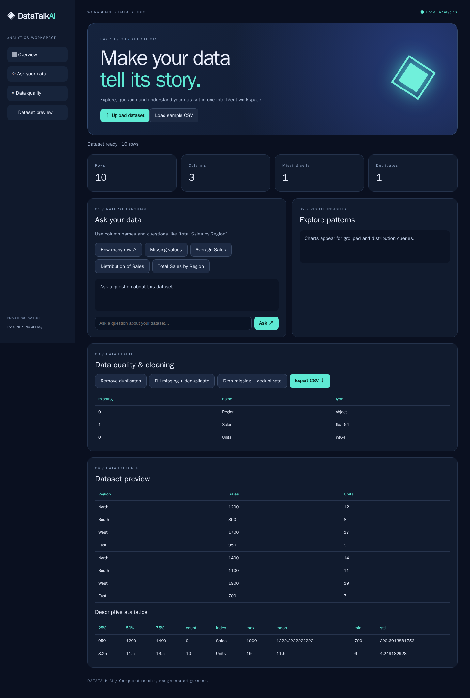
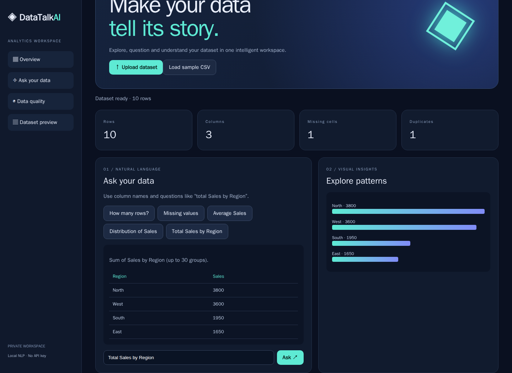
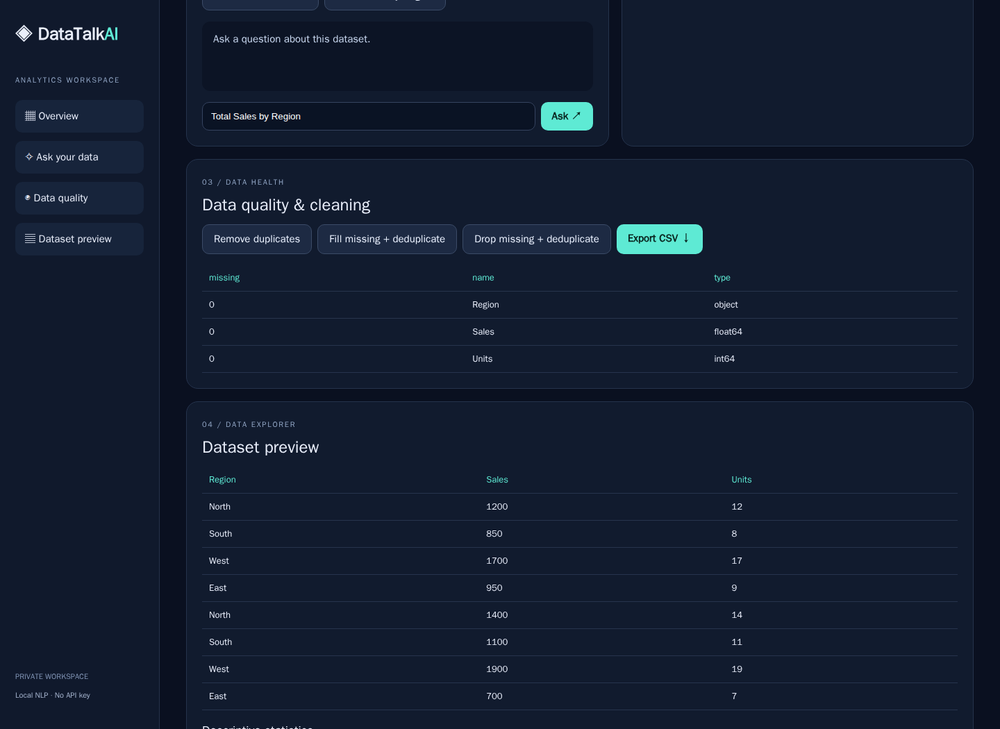

# DataTalk AI — Day 10/30
A local NLP analytics workspace for CSV/XLSX. TF-IDF and cosine similarity classify supported question intents; Pandas computes answers. No LLM or API key required.

## Run
`pip install -r requirements.txt` then `python app.py` and open http://localhost:8504. For Colab use the companion notebook. Load the included synthetic sales sample or upload your own dataset.

## Supported questions
- How many rows?
- Average Sales
- Total Sales by Region
- Distribution of Sales
- Correlation between Sales and Units
- Missing values / duplicate rows

Use exact column names. Supports a limited set of aggregates, not arbitrary natural language, filters or forecasting. Charts show magnitude (absolute bar length) and signed numeric labels. Cleaning removes duplicates and optionally drops missing rows or fills numeric values with median and categorical values with mode. All-null numeric columns remain missing. Data is held in server memory per browser session until restart; this is a single-user development prototype, not a production service. Do not upload confidential data through a public tunnel. Sample data is fictional, calculations are real.

## Screenshots
Run `python capture.py` while the server is running after installing Playwright and Chromium. The script captures actual computed results from the sample CSV.

<!-- captures -->

